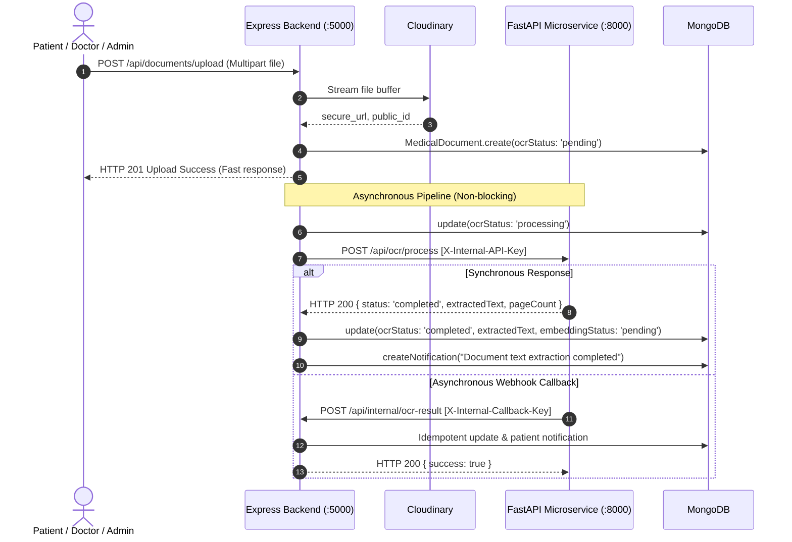

# Node-to-OCR Integration Guide & Testing Suite (Prompt 14)

*HETEROHMS Express Backend ↔ FastAPI Python OCR Microservice*

---

## 🏗️ Architecture & Communication Flow



---

## 🔑 Environment Variables Required

### Node.js Backend (`server/.env`):
```env
AI_SERVICE_URL=http://localhost:8000
AI_SERVICE_INTERNAL_KEY=heterohms_internal_secret_key_2026
INTERNAL_CALLBACK_KEY=heterohms_callback_secret_key_2026
```

### Python FastAPI Microservice (`ai-service/.env`):
```env
PORT=8000
HOST=0.0.0.0
INTERNAL_API_KEY=heterohms_internal_secret_key_2026
NODE_BACKEND_CALLBACK_URL=http://localhost:5000/api/v1/internal/ocr-result
INTERNAL_CALLBACK_KEY=heterohms_callback_secret_key_2026
```

---

## 🧪 Local Testing Instructions (cURL & Postman)

### Scenario 1: Verify Unauthorized Access to Callback Route is Blocked (401)
Public users or attackers attempting to invoke `/api/internal/ocr-result` without credentials are immediately blocked:

```bash
curl -i -X POST http://localhost:5000/api/internal/ocr-result \
  -H "Content-Type: application/json" \
  -d '{
    "documentId": "652431289abcdef012345678",
    "status": "completed",
    "extractedText": "Malicious injected text"
  }'
```

**Expected Response (HTTP 401 Unauthorized):**
```json
{
  "success": false,
  "message": "Unauthorized: Missing required X-Internal-Callback-Key header."
}
```

---

### Scenario 2: Successful OCR Callback Delivery
Microservice delivering extracted clinical text to the backend:

```bash
curl -i -X POST http://localhost:5000/api/internal/ocr-result \
  -H "Content-Type: application/json" \
  -H "X-Internal-Callback-Key: heterohms_callback_secret_key_2026" \
  -d '{
    "documentId": "652431289abcdef012345678",
    "status": "completed",
    "extractedText": "CLINICAL REPORT\nPatient: Rahul Verma\nDiagnosis: Hypertension\nRx: Atorvastatin 20mg",
    "pageCount": 1,
    "warnings": []
  }'
```

**Expected Response (HTTP 200 OK):**
```json
{
  "success": true,
  "message": "OCR callback processed successfully.",
  "data": {
    "documentId": "652431289abcdef012345678",
    "ocrStatus": "completed",
    "embeddingStatus": "pending",
    "pageCount": 1
  }
}
```

---

### Scenario 3: Idempotent Retries
If the callback is delivered multiple times due to network retries, the backend detects identical data and skips redundant database updates or duplicate notifications.

---

### Scenario 4: Extraction Failure Handling
If OCR extraction fails due to illegible scan or corrupted file:

```bash
curl -i -X POST http://localhost:5000/api/internal/ocr-result \
  -H "Content-Type: application/json" \
  -H "X-Internal-Callback-Key: heterohms_callback_secret_key_2026" \
  -d '{
    "documentId": "652431289abcdef012345678",
    "status": "failed",
    "error": "Document scan is too blurry to resolve legible characters.",
    "warnings": []
  }'
```

**Outcome:**
- `MedicalDocument.ocrStatus` set to `'failed'`.
- `ocrError` set to safe message without leaking server stack trace.
- Patient receives notification: *"Document text extraction could not be completed for [filename]. Please ensure document is legible."*

---

### Scenario 5: Manual OCR Retry
Patients or attending doctors can re-trigger extraction on a failed document via the Express API:

```bash
curl -i -X POST http://localhost:5000/api/documents/652431289abcdef012345678/retry-ocr \
  -H "Cookie: jwt=YOUR_SESSION_COOKIE"
```

---

## 🔒 Security & Data Integrity Guarantees

1. **Non-Blocking User Experience:** Document upload response returns HTTP 201 in under 1 second without waiting for OCR extraction.
2. **Double-Delivery Idempotency:** Duplicate callbacks do not corrupt database records or spam patient notification feeds.
3. **Out-of-Order Safety Guard:** A delayed failure callback cannot overwrite an already completed document.
4. **Credential Isolation:** Error logs and patient notifications sanitize internal keys and system paths.
