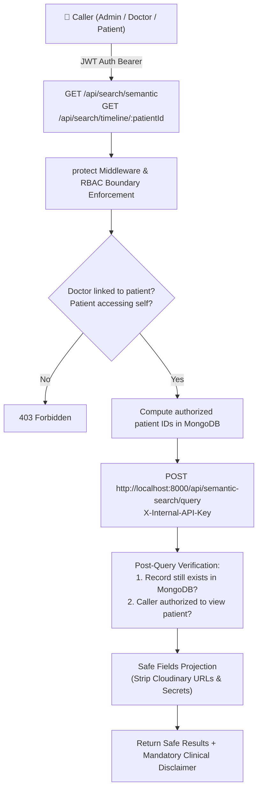

# Semantic Search & Medical Timeline Integration Guide (Prompt 16)
*HETEROHMS Hospital — Node-Authorized Semantic Search*

---

## 📌 Architecture Overview

Prompt 16 integrates the standalone Python FastAPI Semantic Search microservice (Prompt 15) into the Node.js/Express backend (`server/`) with strict Role-Based Access Control (RBAC), multi-patient isolation, post-query authorization verification, and automatic indexing and purging triggers.



---

## 🛡️ Security Guarantees & RBAC Boundaries

| Role | Query Permission | Patient Filter Policy | Post-Query Validation |
| :--- | :--- | :--- | :--- |
| **Admin** | Hospital-wide search across all records | May filter by any `patientId` or omit to search entire hospital | Full access across all verified records |
| **Doctor** | Only patients clinically linked via appointments or medical records | **Must not search all patients by omitting patientId.** Backend computes `authorizedLinkedPatientIds` and applies strict filter. If unlinked `patientId` passed $\rightarrow$ **HTTP 403 Forbidden**. | Post-query verification checks `authorizedLinkedPatientIds.includes(recordPatientId)` |
| **Patient** | Only their own personal records | Strictly locked to `req.user._id`. If external `patientId` supplied $\rightarrow$ **HTTP 403 Forbidden**. | Post-query verification verifies `recordPatientId === req.user._id` |

---

## 📡 API Endpoints

### 1. Semantic Natural Language Search
- **Endpoint:** `GET /api/search/semantic?q=<query>&patientId=<optional>&sourceType=<optional>&documentType=<optional>&page=<optional>&limit=<optional>`
- **Access:** Protected (Authenticated JWT)
- **Validation Rules:**
  - Query string `q`: Minimum 3 characters, maximum 300 characters.
  - `sourceType`: Optional, allowed: `medical_document`, `medical_record`, `prescription`.
  - `documentType`: Optional, allowed: `lab-report`, `prescription`, `discharge-summary`, `xray`, `mri`, `medical-record`, `scan`, `other`.
- **Response Format:**
```json
{
  "success": true,
  "query": "hypertension follow-up notes",
  "totalResults": 1,
  "page": 1,
  "totalPages": 1,
  "results": [
    {
      "sourceType": "medical_record",
      "sourceId": "652431289abcdef012345678",
      "patientId": "652431289abcdef012345671",
      "documentType": "medical-record",
      "title": "EHR: Essential Hypertension",
      "createdAt": "2026-03-15T09:30:00.000Z",
      "snippet": "Clinical Record Diagnosis: Essential Hypertension. Reported Symptoms: Mild headache, dizziness...",
      "relevanceScore": 0.8924
    }
  ],
  "disclaimer": "Results are for record retrieval and do not constitute medical advice or diagnosis."
}
```

### 2. Patient Chronological Medical Timeline
- **Endpoint:** `GET /api/search/timeline/:patientId`
- **Access:** Protected (Patient self, Doctor linked, Admin any)
- **Combines:** Appointments, Medical Records (EHR), Prescriptions, and Uploaded Documents into unified reverse-chronological event timeline.
- **Response Format:**
```json
{
  "success": true,
  "patient": {
    "id": "652431289abcdef012345671",
    "name": "Jane Doe",
    "email": "jane@example.com"
  },
  "totalEvents": 4,
  "timeline": [
    {
      "id": "6524...",
      "type": "prescription",
      "date": "2026-03-15",
      "time": "10:30:00",
      "title": "Prescription issued (2 medicines)",
      "summary": "Amlodipine, Telmisartan",
      "status": "active",
      "badge": "Prescription",
      "badgeColor": "emerald",
      "metadata": {
        "doctorName": "Dr. Sarah Jenkins",
        "medicinesCount": 2,
        "instructions": "Take daily after breakfast"
      }
    }
  ],
  "disclaimer": "Results are for record retrieval and do not constitute medical advice or diagnosis."
}
```

---

## ⚡ Asynchronous Non-Blocking Lifecycle Triggers

1. **Document OCR Completion**:
   - In `server/src/services/ocrIntegrationService.js`, when OCR completes, `triggerDocumentIndexing(doc)` is called via non-blocking `setImmediate`.
   - Updates `MedicalDocument.embeddingStatus` to `processing` $\rightarrow$ `completed` / `failed`.
   - Sends in-app patient notification when indexing finishes.

2. **Medical Record Created / Updated / Deleted**:
   - In `server/src/controllers/medicalRecordController.js`:
     - On Create/Update: `triggerMedicalRecordIndexing(record)` embeds diagnosis, symptoms, physician notes, and follow-up date.
     - On Delete: `deleteSourceFromIndex(recordId, 'medical_record')` purges vectors from ChromaDB.

3. **Prescription Created / Updated / Deleted**:
   - In `server/src/controllers/prescriptionController.js`:
     - On Create/Update: `triggerPrescriptionIndexing(prescription)` embeds medicine names, dosage, frequency, and instructions.
     - On Delete: `deleteSourceFromIndex(prescriptionId, 'prescription')` purges vectors from ChromaDB.

4. **Medical Document Deleted**:
   - In `server/src/controllers/documentController.js`:
     - On Delete: `deleteSourceFromIndex(documentId, 'medical_document')` purges vectors from ChromaDB.

---

## 🧪 Security & Verification Test Results

Execute the security test suite:
```bash
cd server
node src/tests/search_security.test.js
```

### Verified Test Suite Output:
```text
====================================================
RUNNING SEMANTIC SEARCH SECURITY TEST SUITE (Prompt 16)
====================================================

  [PASS]: Rejects query with fewer than 3 characters with HTTP 400
  [PASS]: Rejects query exceeding 300 characters with HTTP 400
  [PASS]: Patient A cannot query Patient B data even when passing Patient B ID (HTTP 403)
  [PASS]: Doctor cannot query an unassigned patient (HTTP 403 Forbidden)
  [PASS]: Post-query verification strictly removes unauthorized records before responding
  [PASS]: Microservice offline fails safely returning 0 results with clinical disclaimer and no secrets leaked
  [PASS]: Purging deleted source records dispatches background cleanup without blocking database deletion
  [PASS]: Search results include safe fields only (no raw Cloudinary URLs or system secrets)

====================================================
TEST SUMMARY: 8 Passed, 0 Failed
====================================================
```
